# Ultimate Theater User Manual

**Your movies. Your theater.**

Version 1.0 · for macOS 27.0 or later

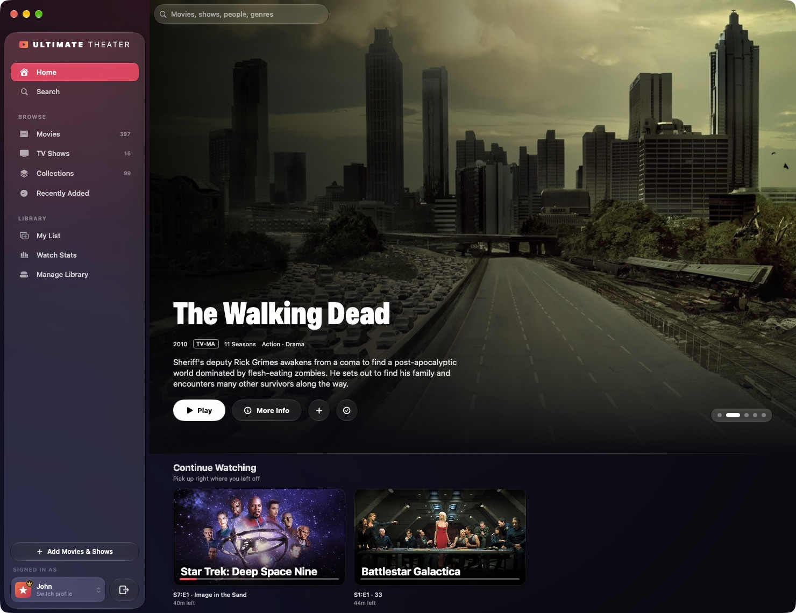

Ultimate Theater turns the movies and TV shows on your Mac, external drives and network storage (NAS) into a personal streaming service. It has its own playback engine, finds posters, cast lists and episode guides automatically, has profiles for everyone in the household, and can cast to the TVs in your home.

## Contents

1. [Getting started](#1-getting-started)
2. [Adding media](#2-adding-media)
3. [Browsing your library](#3-browsing-your-library)
4. [Watching](#4-watching)
5. [Casting and AirPlay](#5-casting-and-airplay)
6. [iPhone remote](#6-iphone-remote)
7. [Watch Stats](#7-watch-stats)
8. [Settings reference](#8-settings-reference)
9. [Parental controls and ratings](#9-parental-controls-and-ratings)
10. [Privacy](#10-privacy)
11. [Troubleshooting and FAQ](#11-troubleshooting-and-faq)
12. [Keyboard shortcuts](#12-keyboard-shortcuts)
13. [Data sources and trademarks](#13-data-sources-and-trademarks)

---

## 1. Getting started

### System requirements

- macOS 27.0 or later.
- Your movie and TV files, on the Mac, an external drive, or a network share (SMB, AFP, NFS or NAS).
- An internet connection, to look up movie and TV information. Playback itself works offline.
- Optional: free API keys for TMDB, OMDb and OpenSubtitles.

### The setup guide

The first time you open Ultimate Theater, a short setup guide takes you through seven steps. A progress bar at the top shows where you are, and you can go **Back** at any time.

1. **Welcome.** An overview of what's coming. Click **Get Started**.
2. **Profile.** Type your name, then pick a color and an icon, or click **Choose Picture…** to use a photo. The first profile is always the **household administrator**. It can watch everything and manage the library.
3. **Protection.** Click **Set Administrator PIN…** and choose a four-digit PIN for the household. This step is optional (**Skip**), and you can set the PIN later in Settings.
4. **Library.** Click **Add Movies Folder…** or **Add TV Shows Folder…** and choose the folders where your videos are. Ultimate Theater finds every movie and episode inside, looks up its details, and keeps watching those folders for new files.
5. **Sources.** Choose where movie and TV information comes from: **TMDB** (recommended), **TVmaze**, **OMDb** and **Wikipedia**. TMDB and OMDb each need a free API key. Paste it in and click **Check Key**. TVmaze and Wikipedia work without a key. Use **Test Connection** to check them.
6. **Ratings.** Choose your **Ratings country**. It decides which age rating is shown for each title, and what profiles with a content limit can watch.
7. **Ready.** Click **Start Watching**.

### Profiles

Each person in the household can have their own profile, with its own My List, watch progress, ratings, favourite scenes and Watch Stats.

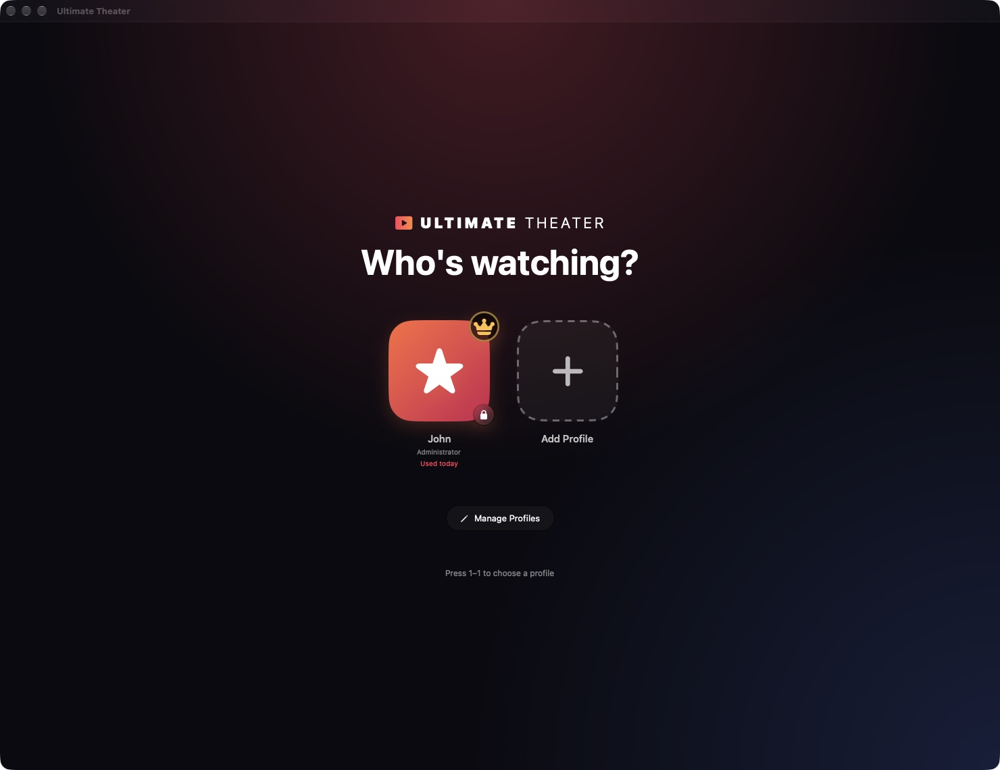

- **Choosing a profile.** The **Who's watching?** screen appears when you open the app or log out. Click a profile, or press its number (1–9). A gold crown marks the administrator, and a lock badge means the profile has a PIN.
- **Adding a profile.** Click **Add Profile** (⇧⌘N).
- **Editing or removing a profile.** Click **Manage Profiles** (⌘E) and choose a profile, or right-click it and choose **Edit Profile…**. In the editor you can change:
  - **Name**, **Color** and **Icon**, or a picture. Click **Choose Picture…**, or drag an image onto the large avatar.
  - **Lock with PIN.** The profile asks for its own four-digit PIN every time it's opened.
  - **Role › Household administrator.** Only one profile can be the administrator. To change it, make another profile the administrator.
  - **Content Ratings.** Choose **Little Kids**, **Older Kids**, **Teens** or **All Ratings**, and decide whether to **Show unrated titles**.
  - **Remove Profile** deletes the profile, along with its My List, watch progress and ratings.
- **Switching profiles.** Click your name at the bottom of the sidebar to switch to someone else or choose **Manage Profiles…**. Click the button next to it to **Log Out**. You can also use the **Profile** menu in the menu bar. **Switch Profile…** is ⇧⌘P.

### The administrator and PINs

The administrator manages the household. Only the administrator can add and approve media, manage the library, and change Settings (Playback is the one pane every profile can change).

When an **administrator PIN** is set, you need it to:

- add, edit or remove profiles,
- open the administrator's profile from another profile,
- move from a profile with a content limit to one with a higher limit (a limited profile stays in effect after logging out until the PIN is entered),
- add, remove, delete, repair or approve media, stop watching a folder, and change saved API keys,
- turn the iPhone remote on or off, and reset the app.

**Wrong guesses.** After five wrong PINs, the PIN pad makes you wait before trying again. The wait starts at 30 seconds and doubles with each further miss, up to 15 minutes. The wait carries over if you quit and reopen the app.

**Forgot the PIN?** When you're asked for the administrator PIN, click **Forgot PIN? Use Mac Password…**. After you sign in with your Mac's password, Touch ID or Apple Watch, the administrator PIN is removed. You can then set a new one in **Settings › Parental Controls**.

### Metadata sources and API keys

Ultimate Theater combines several sources. TMDB is used first for every detail it has, and the others fill in ratings, episode guides and anything TMDB is missing.

| Source | What it adds | Key |
| --- | --- | --- |
| **TMDB** (main source) | Posters, backdrops, cast, genres, ratings, episode details, trailers, movie collections | Free API key or read access token |
| **TVmaze** | TV shows and full episode guides | None needed |
| **OMDb** | IMDb, Rotten Tomatoes and Metacritic scores, plus US age ratings | Free API key |
| **Wikipedia** | Synopses and posters | None needed |

You can add or change keys in **Settings › Metadata**:

- Each source has an on/off switch, an **API Key** field, a **Get a Free Key** (or **Manage Key**) link, and **Test Connection**.
- **TMDB key.** Create a free TMDB account, open Settings → API on the TMDB website, and copy the "API Key". A read access token also works.
- **OMDb key.** Request a free key with your email address on the OMDb website. It usually arrives within a minute.
- **OpenSubtitles key** (for **Find Subtitles…**). Create a free "API consumer" on opensubtitles.com and paste its key into the **OpenSubtitles** section. Adding your OpenSubtitles username and password is optional, but it raises your daily download limit. Click **Check** to test it.
- Keys are stored in your Mac's **Keychain**. When an administrator PIN is set, a saved key is shown as **Key saved ••••1234**, and you need the PIN to change it (**Change Key…**).
- **Fetch info automatically when adding media** looks up each title as soon as it's added.

---

## 2. Adding media

Only the administrator can add media.

### Adding files and folders

- Click **Add Movies & Shows** in the sidebar, choose **File › Add Movies & Shows…** (⌘O), or use **Add Movies & Shows…** in Manage Library. You can select individual video files, whole folders, or both.
- **Drag and drop.** Drag files or folders anywhere into the main window. The window shows "Drop to Add to Your Library" while you drag.
- A banner at the bottom of the window shows progress while files are scanned and identified.
- Folders you add become **watched folders** (see below).

### Naming your files

Ultimate Theater works out the title, year, season and episode from each file's name and the folders around it. These names give the best matches:

| What it is | Example name | What the app reads |
| --- | --- | --- |
| Movie | `Heat (1995).mp4` | *Heat*, 1995 |
| Movie in its own folder | `Inception (2010)/movie.mkv` | *Inception*, 2010 (from the folder) |
| Scene-style release | `The.Matrix.1999.1080p.BluRay.x264.mkv` | *The Matrix*, 1999 |
| Episode | `Show S01E02.mp4` or `Severance - S01E02 - Half Loop.mp4` | Season 1, episode 2, "Half Loop" |
| Spelled-out episode | `Show Season 4 Episode 22 - Title.mkv` | Season 4, episode 22, "Title" |
| Short form | `the.office.us.2x05.mp4` | Season 2, episode 5 |
| Season folders | `Breaking Bad/Season 3/07 - One Minute.m4v` | *Breaking Bad*, season 3, episode 7 |

Tags in brackets such as `[YTS]`, and release labels such as `1080p`, `BluRay` or `x265`, are ignored. "Sample" clips (`sample.mkv`, `Movie-sample.mkv`) are skipped.

**Supported files:** MP4, M4V, MOV, 3GP, MKV, WebM, AVI, MPEG-TS and M2TS/MTS (Blu-ray and AVCHD), MPG and VOB (MPEG program streams), Ogg/OGV, FLV/F4V, and DV. WMV and ASF files are added, but they're marked as unplayable.

### Watched folders, network drives and approval

- **New videos need approval.** Folders you add are watched. When new videos show up in them, they wait under **Waiting for Approval** at the top of **Manage Library**. Click **Add** or **Add All** to put them in your library, or **Ignore…** / **Ignore All…** to leave them out. Ignored files stay on your Mac.
- **Deleted files leave the library automatically.** If a video is deleted from a watched folder, its title is removed from the library.
- **Disconnected drives are kept.** If a drive or network share is disconnected, its titles stay in your library and play again when it's reconnected.
- **Network drives (NAS) are checked every 5 minutes.** They don't report changes the way local drives do. They're also checked right away when they reconnect.
- **Rescan Library Folders** (⇧⌘R, or **Rescan Folders** in Manage Library) checks every watched folder now.
- **To stop watching a folder,** click the **–** button next to it in Manage Library, or click **Remove…** in **Settings › Library**. Its titles stay in your library, and no files are deleted.

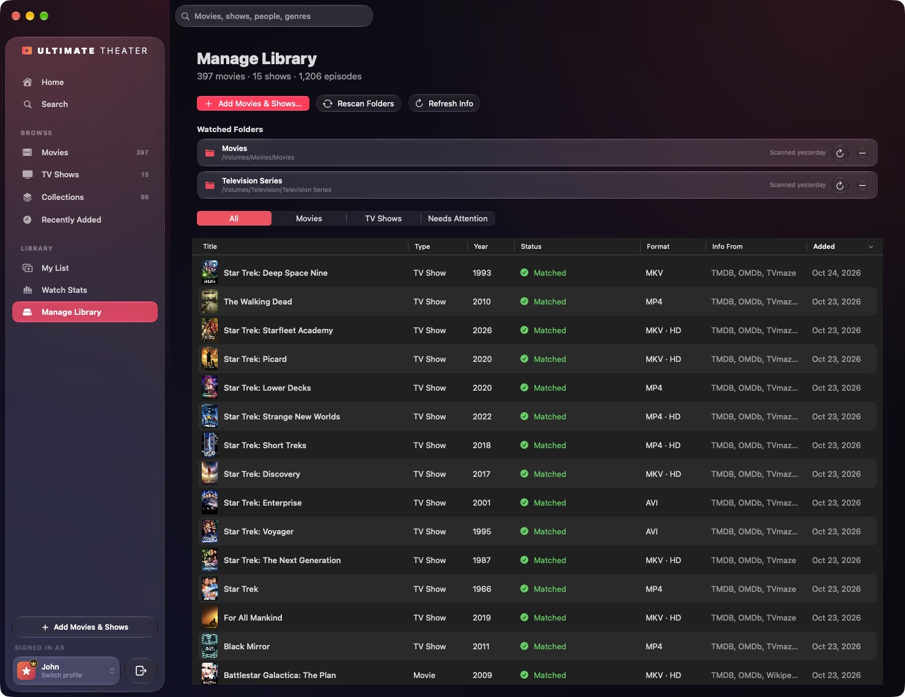

### Manage Library

**Manage Library** (⌘7) is where you look after the whole collection:

- **Summary.** The number of movies, shows and episodes.
- **Action bar.** **Add Movies & Shows…**, **Rescan Folders**, and **Refresh Info** (for Movies, TV Shows, one folder, or Everything). When some titles weren't recognized, an **Identify *n* Unmatched** button also appears.
- **Watched Folders.** When each folder was last scanned, a button to refresh that folder's info, and a button to stop watching it.
- **Titles table.** Columns for Title, Type, Year, Status (*Matched*, *Needs Match*, *Not Fetched* or *Unsupported*), Format, Info From and Added. Filter the table with **All**, **Movies**, **TV Shows** or **Needs Attention**.
- The **Manage Library** item in the sidebar shows an orange badge when titles need attention or videos are waiting for approval.

### Refresh Info, Fix Match and Edit Info

- **Refresh Info** downloads the latest information again. You can refresh one title (from the **Library Actions** menu (…) at the top of its page), a whole page (the **Refresh Info** button on Movies or TV Shows), or everything (**File › Refresh All Info**).
- **Fix Match…** helps when a title was matched to the wrong movie or show, or wasn't recognized at all (marked **Needs Match**). Type the right title and year, click **Search**, then click **Use This Match**. The info, artwork and ratings are replaced.
- **Edit Info…** lets you change the Title, Year, Rating, Tagline, Synopsis, Genres, Poster URL and Backdrop URL yourself. Turn on **Lock info** to keep your edits when info is refreshed. Ratings still update.

You'll find all three in the title page's **Library Actions** menu, by right-clicking a poster, and in the Manage Library table.

### Removing and deleting

On a title page, click **Delete**:

- **Remove from Library** takes the title out of Ultimate Theater and leaves the video files on your Mac.
- **Move File to Trash** (for a show, **Move All Episode Files to Trash**) removes the title and moves its files to the Trash.

**Remove from Library…** is also in the Library Actions menu and in the Manage Library table.

### Repairing damaged files

Ultimate Theater can find and fix common damage in every format it plays: a missing or broken index, a file that was cut off partway, lost sync, and bad packets or pages. The original file is never changed. A repaired copy is saved where you choose.

1. Open the title's page. If the file is damaged, a notice with a **Repair…** button appears. You can also choose **Check File for Damage…** from the **Library Actions** menu.
2. Ultimate Theater checks the file and shows what it can recover.
3. Click **Save Repaired Copy…** and choose where to save it. Then click **Use in Library** to play the repaired copy from now on.

If an MP4 or MOV file was never finished (for example, because a copy or an export was interrupted), Ultimate Theater looks for a healthy file made the same way to rebuild the missing information. If part of the movie was never copied into the file, the repaired copy ends where the file does.

---

## 3. Browsing your library

### Home

Home opens with a **hero carousel** of featured titles, each with **Play**, **More Info**, **+** (add to My List) and **✓** (mark watched). Below it are rows that only appear when there's something to show in them:

- **Continue Watching**, with how much time is left. Right-click a card to **Resume**, **Start Over**, **View Details**, mark the episode or series as watched, or **Remove from Continue Watching**.
- **Recently Watched**, **Recently Added** and **Top Rated in Your Library**.
- **My List**, and **Because You Watched…**.
- **Movies**, **TV Shows**, **Browse by Genre**, and a row for each genre.

Right-click any poster to **Play**, **View Details**, add it to or remove it from My List, or mark it as watched or unwatched. The administrator also sees **Fix Match…**, **Edit Info…** and **Show in Finder** there.

### Movies and TV Shows

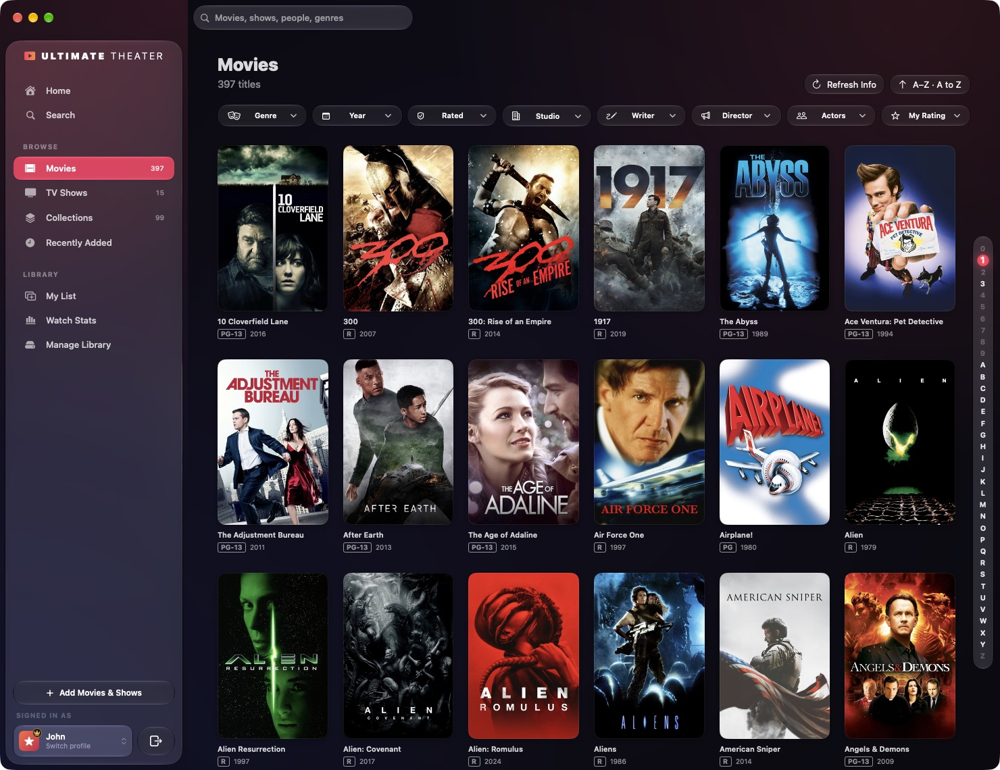

**Movies** (⌘2) and **TV Shows** (⌘3) show your whole collection as a grid of posters.

- **Filters.** Use **Genre**, **Year**, **Rated**, **Studio**, **Writer**, **Director**, **Actors** and **My Rating**. Each one is a menu where you can pick several values, search within the list, and **Clear** your choices. The heading shows how many titles match. When nothing matches, click **Clear Filters**.
- **A–Z bar.** The letters down the right edge (0–9, A–Z) jump straight to that part of the grid.
- **Refresh Info.** The administrator can refresh every title on the page at once.

**Sort.** The sort menu at the top right has a submenu for each order, each with two directions:

| Sort by | Directions |
| --- | --- |
| Recently Added | Oldest Added First, Newest Added First |
| A–Z | A to Z, Z to A |
| Release Date | Oldest First, Newest First |
| Top Rated | Lowest First, Highest First |
| My Rating | Lowest First, Highest First |

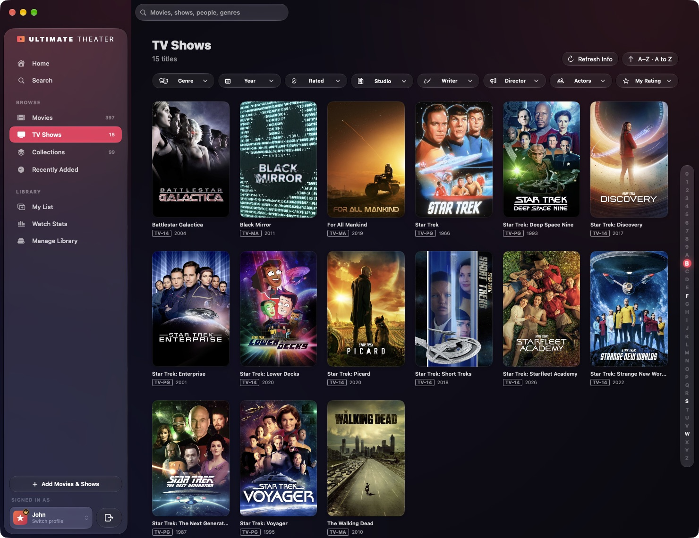

### Collections and Made for You

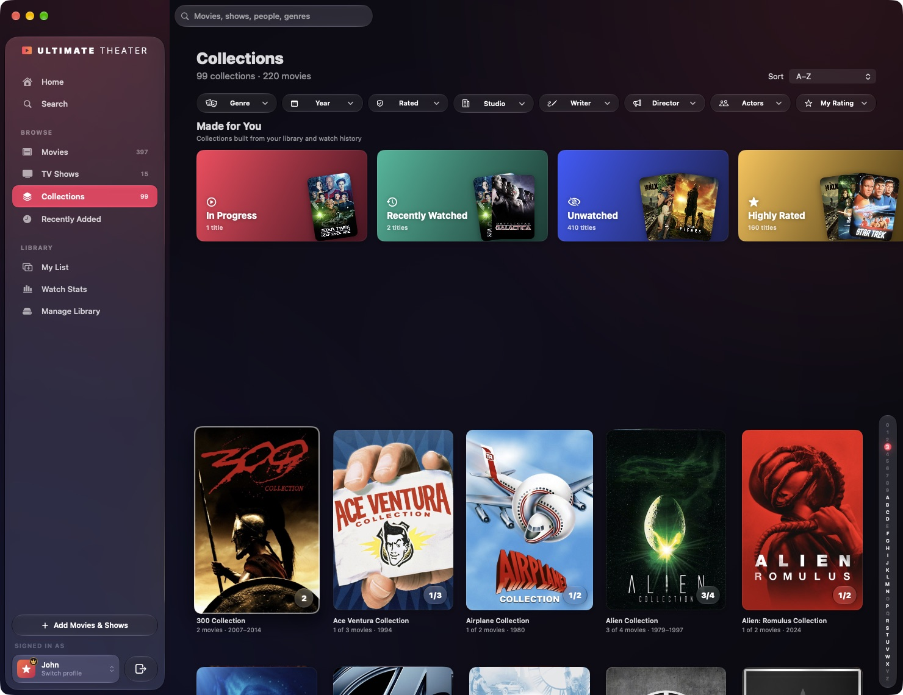

**Collections** (⌘4) groups movies that belong to a series, such as *Alien* or *Toy Story*. Collections come from TMDB, so you need a TMDB key.

- Each collection shows how many of its movies you have (for example, **3/4**). Movies you don't have appear as **Not in Library** placeholders.
- A collection's page has **Play from the Beginning**, or **Continue with** the next movie you haven't seen.
- **Sort** collections by A–Z, Recently Added, Release Date or Most Movies, and use the same filters as the Movies page.

**Made for You** collections are built from your library and your own watch history:

- **In Progress** — titles you've started but not finished.
- **Recently Watched** — the newest first.
- **Unwatched** — titles you haven't started.
- **Highly Rated** — critics' favourites (a critic score of 80 or more).
- **One for each decade** that has at least three titles, such as *The 1990s*.

### Recently Added, My List and Search

- **Recently Added** (⌘5) has three tabs: **Recently Added**, **Newest Releases** and **Top Rated**.
- **My List** (⌘6) holds what you want to watch next. Add a title with the **+** button, from the poster's right-click menu, or with **My List** on its page (⌘L).
- **Search** (⌘F) finds movies, shows, people and genres. As soon as you type, the results appear.

### Title pages

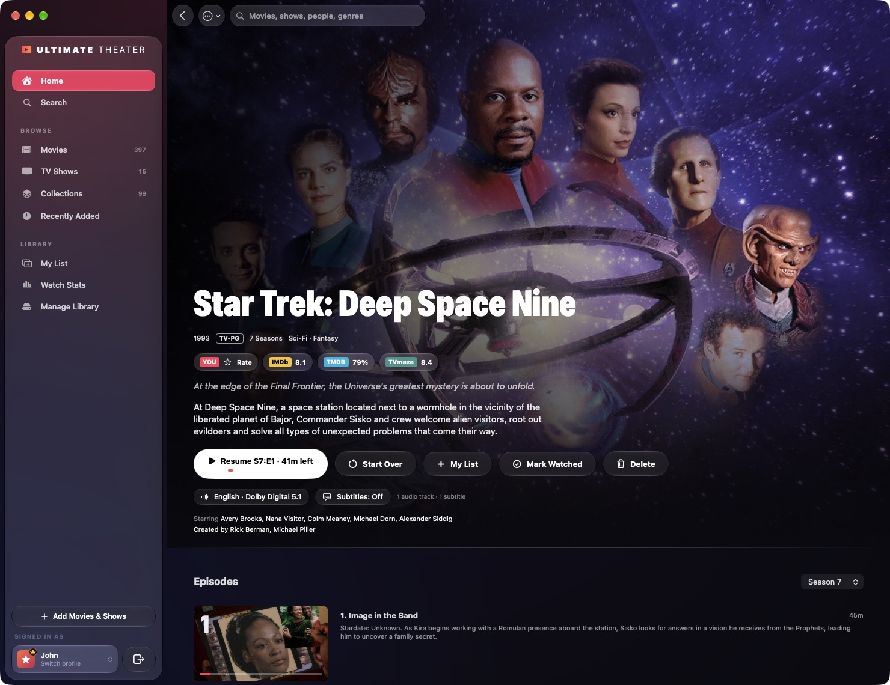

Click a poster to open its page. At the top you'll find:

- **The title, year, age rating, length or number of seasons, and genres.**
- **Ratings.** Your own rating (**YOU · Rate**: from half a star to ten stars, in half-star steps), plus scores from IMDb, Rotten Tomatoes, Metacritic, TMDB and TVmaze when they're available.
- **The tagline and synopsis.**
- **Buttons:**
  - **Play**, or **Resume** with the time left (Return).
  - **Start Over**.
  - **My List** (⌘L).
  - **Mark Watched**, which you can click again to mark the title unwatched.
  - **Trailer** (⇧⌘T), when there is one. Trailers play in YouTube's or Vimeo's own player.
  - **Delete** (administrator only).
- **Audio and subtitle pickers** for the file, with **Find Subtitles…** (see [Finding subtitles](#finding-subtitles)). If you change them before playing, Ultimate Theater asks whether to keep the choice: **Always Use These Settings**, **Use for This Movie Only** (or **Show Only**), or **Just This Time**.
- **Starring, Director or Creator**, and **Part of…** when the movie belongs to a collection.

Further down the page:

- **Episodes** (for shows), with a season picker. Hover over an episode to play it or to mark it watched (✓). Right-click it to mark the episode, the season or the whole series as watched or unwatched.
- **About.** Genres, rating, release date, cast, director, scores, audio and subtitle tracks, file format, where the file is stored, and which sources the info came from.
- **Favourite Scenes.** Moments you saved while watching (see [Saving a scene](#saving-a-scene)). Click one to play from that moment, or click **×** to remove it.
- **More Like This.**

For the administrator, the **Library Actions** menu (…) at the top of the page has **Refresh Info**, **Fix Match…**, **Edit Info…**, **Show in Finder**, **Check File for Damage…** and **Remove from Library…**.

---

## 4. Watching

Every file plays in Ultimate Theater's own **Theater engine**. You don't need any extra codecs or apps.

**What the Theater engine plays:**

- **Video:** H.264, HEVC (including HDR10, HLG and Dolby Vision), AV1, VP9, VP8, Theora, MPEG-1, MPEG-2, MPEG-4 Part 2 (Xvid/DivX), H.263, Apple ProRes, DV and Motion JPEG.
- **Audio:** AAC (including LATM broadcast audio), Apple Lossless, FLAC, Opus, Vorbis, Dolby Digital, Dolby Digital Plus, Dolby TrueHD (lossless, including Atmos beds), DTS (the core, including the core of DTS-HD tracks), MP3, MP2, PCM and LPCM, ADPCM, µ-law, A-law and AMR.
- **Subtitles:** SRT, ASS/SSA, MP4 text, Blu-ray PGS, DVD subtitles (VobSub), DVB subtitles and Teletext. Separate `.srt` or `.vtt` subtitle files are also supported.

### The player

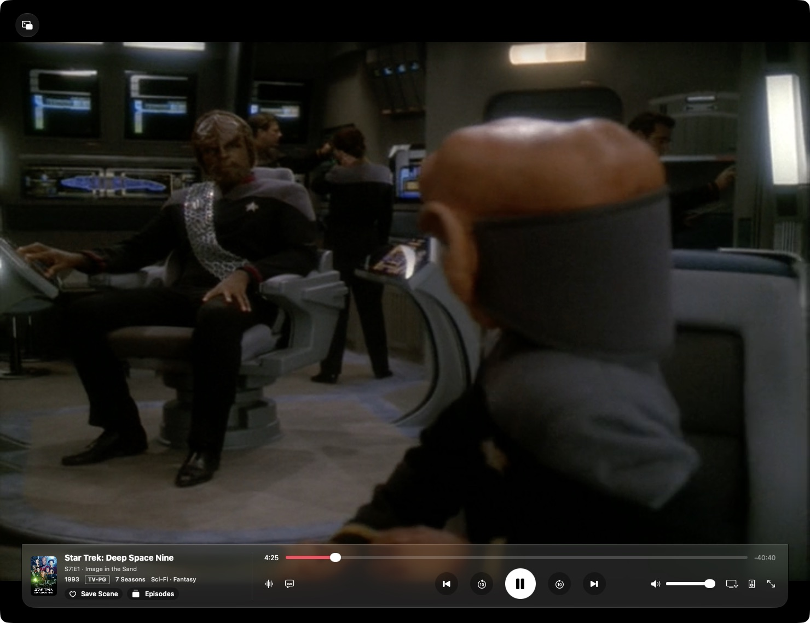

The player fills the window. Along the bottom is one glass bar:

- **On the left, the title's info.** The poster, title, episode, year, rating and genres, with **Save Scene** and, for shows, **Episodes**.
- **On the right, the controls:**
  - A timeline showing the time played and the time left. Drag it to jump to another point.
  - **Previous** and **Next episode** (for shows).
  - **Back 10 seconds**, **Play/Pause** and **Forward 10 seconds**.
  - The **Audio** menu (waveform icon) and the **Subtitles** menu (speech-bubble icon).
  - **Mute** and a volume slider.
  - **Cast**, **AirPlay** and **Sound Output**.
  - **Full Screen**.

The controls hide after 3 seconds while a video plays. Move the pointer or press a key to bring them back. Double-click the picture to enter or leave full screen. The **picture-in-picture** button is at the top left.

### Playback shortcuts

These shortcuts work while the player fills the window. Most of them are also in the **Playback** menu.

| Key | Action |
| --- | --- |
| Space | Play / Pause |
| ← / → | Back / Forward 10 seconds |
| ⇧← / ⇧→ | Previous / Next episode |
| ↑ / ↓ | Volume up / down |
| S | Skip Intro or Skip Credits (whichever is showing) |
| M | Mute / Unmute |
| F | Toggle full screen |
| B | Save Scene (add this moment to Favourite Scenes) |
| N | Play Now (on the Up Next card) |
| Escape | Close the Episodes panel, then leave full screen, then shrink to picture-in-picture |
| ⌘↩ | Picture in Picture / Return to Player |
| ⌘. | Stop |

### Audio and subtitle tracks

- **Choosing tracks.** Use the **Audio** and **Subtitles** menus on the player bar, or the pickers on the title page before you start. Tracks the engine can't play are shown greyed out.
- **What gets remembered.** Your choice is remembered for each profile, for all titles or for one title, depending on what you chose when you were asked.
- **Separate subtitle files.** A subtitle file stored next to the video in a watched folder is added automatically, for example `Movie.srt`, `Movie.en.srt` or `Movie.eng.forced.srt`.
- **Disc subtitles.** Blu-ray (PGS) and DVD subtitles appear exactly where the disc places them on the picture.

### Finding subtitles

When a movie or episode has no subtitles in the language you want, choose **Find Subtitles…** from the Subtitles menu, or from the title page.

1. Pick a **Language**. Ultimate Theater searches OpenSubtitles.com.
2. Results can carry these labels:
   - **Matches this file** — found by the file's fingerprint, so the timing should line up exactly.
   - **SDH** — for the deaf and hard of hearing, with sound descriptions.
   - **Forced** — only the foreign-language dialogue.
   - **Machine translated**.
3. Click **Download**. The subtitle is added to the file's track list straight away and is there every time you play it.

You need an OpenSubtitles API key for this (see [Metadata sources and API keys](#metadata-sources-and-api-keys)).

### The Synopsis and Episodes panels

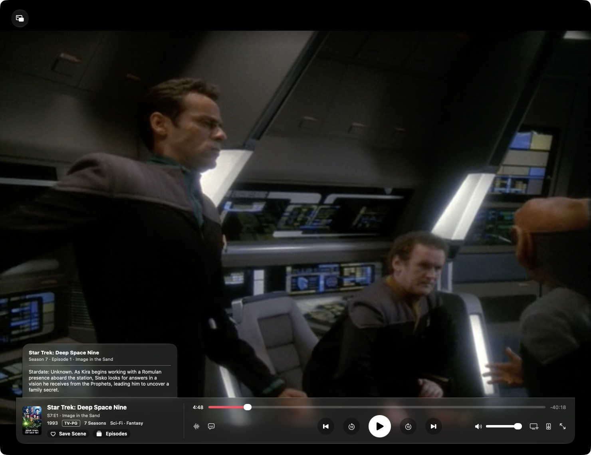

- **Synopsis.** Hover over the info on the left of the player bar. A panel rises above it with the episode's or movie's synopsis. It stays open while the pointer is over it.
- **Episodes.** For shows, click **Episodes**. A panel lists every episode of the current season, with season buttons (**S1**, **S2**, … **Specials**), each episode's length, a ✓ for episodes you've watched, and a speaker icon for the one that's playing. Click an episode to play it. To close the panel, click outside it, press Escape, or click Episodes again.

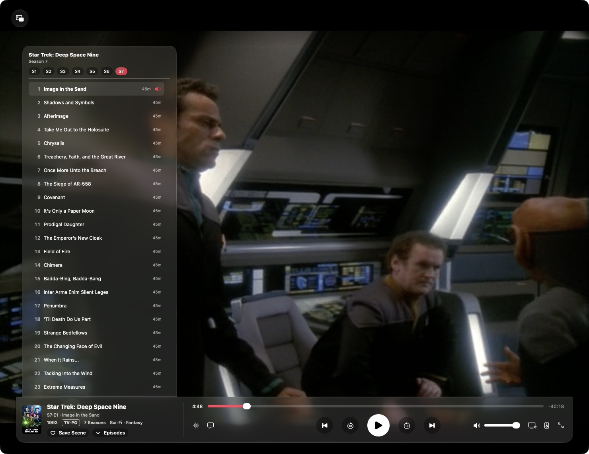

### Paused

When you pause, the picture dims and the title, episode and synopsis appear over it, like on the title page.

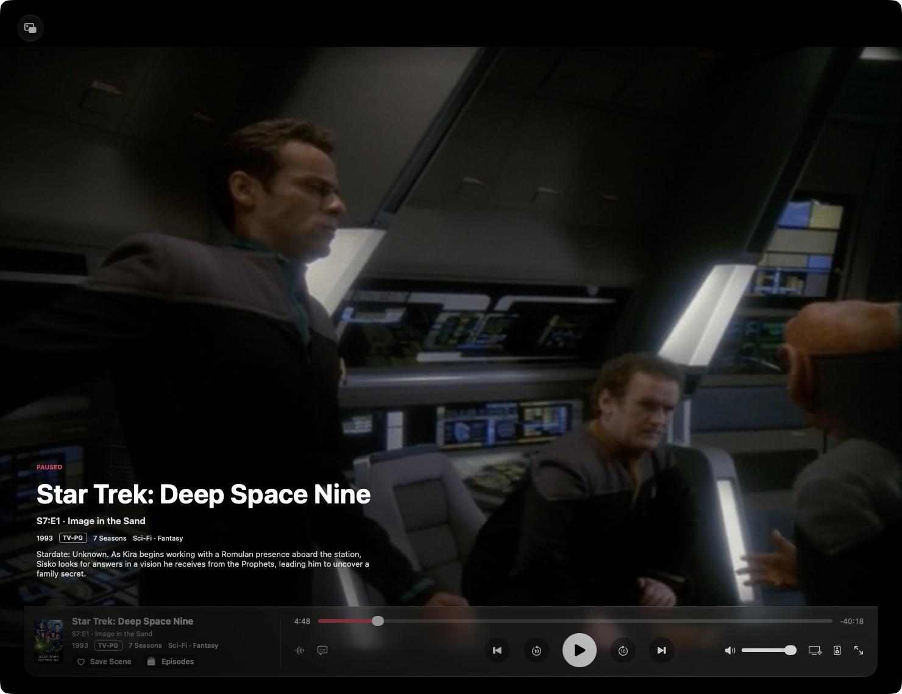

### Saving a scene

Click **Save Scene** (or press B) to save the current moment. It appears under **Favourite Scenes** on the title's page, and you can play from it at any time.

### Skip Intro, Skip Credits and Up Next

- **Skip Intro** jumps to the end of the opening titles. **Skip Credits** plays the next episode, or ends playback after the last one. Click the button, or press S.
- **How intros and credits are found.** For TV episodes, Ultimate Theater uses chapter names when the file has them. Otherwise it compares each episode's sound with the episodes around it, because a theme song repeats from episode to episode but the story doesn't. This happens in the background after you add a show, and starts with the episode you're about to play. For movies, only **Skip Intro** is offered, and only when a chapter is named like an intro.
- **How long the buttons stay.** For episodes, the buttons appear for up to 15 seconds after the intro or credits begin.
- **Up Next** appears once the credits have finished, or in the last 20 seconds when no credits were found. It has **Play Now** (N) and **Dismiss**. When the episode ends, a 15-second countdown runs, then the next episode starts.
- **Are you still watching?** After three episodes in a row play without anyone touching the Mac, the iPhone remote or the media keys, the app pauses and asks **Are you still watching…?** Choose **Continue Watching** or **Back to Browsing**.
- **Turning autoplay off.** Turn off **Play the next episode automatically** in **Settings › Playback**. Up Next is still offered, but the next episode only starts when you choose **Play Now**.

### Picture in picture

Press Escape, press ⌘↩, or click the picture-in-picture button. The video shrinks into the sidebar and keeps playing while you browse.

- Hover over the small player to see **Return to full player**, **Play/Pause** and **Stop and close**. Double-clicking it also returns to the full player.
- Subtitles are hidden while the player is this small.

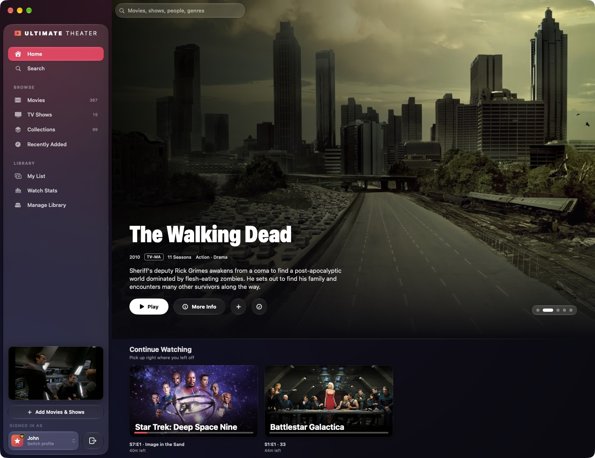

### Full screen

Press F, click **Full Screen**, or double-click the picture. In full screen:

- The sidebar slides in when you move the pointer to the left edge of the screen.
- The toolbar appears when you move the pointer to the top edge.
- Escape leaves full screen.

### Dock, media keys and Now Playing

- **Dock preview.** When you minimize the window during playback, its Dock icon shows the live picture with a play/pause badge.
- **Dock menu.** Right-click the Dock icon for the title playing, **Play/Pause**, **Back 10 Seconds**, **Forward 10 Seconds** and **Stop**.
- **Media keys and Now Playing.** What's playing appears in Control Center's Now Playing. The keyboard's media keys and headphone controls work too.

### Sleep prevention

While a video plays on your Mac, the display stays on. The screen saver, the lock screen and sleep won't interrupt it. While a video plays on an Apple TV or another device, the Mac stays awake but the display can sleep. Normal sleep returns as soon as you pause or stop.

### When a file can't be played

If a file has been moved, renamed or deleted, the player says it can't be found. If it's on an external drive, connect the drive and try again. If the drive is connected and the file is gone, the administrator can click **Remove from Library…**. Damaged files can be repaired (see [Repairing damaged files](#repairing-damaged-files)).

---

## 5. Casting and AirPlay

Click **Cast** on the player bar to see every device on your network that can show the video, grouped by kind. Each device says whether it can play this particular file.

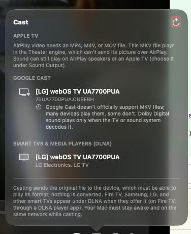

### Device families

| Family | Devices | How it works |
| --- | --- | --- |
| **Apple TV** (AirPlay) | Apple TV and AirPlay TVs | **Video:** MP4, M4V or MOV files with H.264 or HEVC video and AAC, Dolby Digital or Dolby Digital Plus sound, which macOS can play directly. **Other files:** sound only, through **Sound Output**. |
| **Google Cast** | Chromecast, Google TV, Nest displays, TVs with Cast built in | **Files:** MP4, M4V, MOV and WebM (MKV often works, but isn't official). **Video:** H.264 and VP8 on every device. HEVC and VP9 need a Chromecast Ultra, a Chromecast with Google TV, or a TV with Cast built in. **Sound:** AAC, MP3, Opus, Vorbis and FLAC. Dolby sound only plays if the TV or sound system decodes it. |
| **Smart TVs & Media Players** (DLNA) | Most Samsung, LG, Sony, Panasonic and Philips TVs, Xbox, many receivers, Fire TV (through a DLNA player app) | Depends on what the TV says it accepts. Most play H.264, HEVC and MPEG-2 in MP4, MKV or MPEG-TS files. |
| **Roku** | Roku players and Roku TVs | **Files:** MP4, MOV and MKV. **Video:** H.264, plus HEVC, VP9 and AV1 on 4K models. **Sound:** AAC, MP3, Dolby Digital and FLAC (DTS needs a sound system that decodes it). |

While you're casting, the Mac shows the device's name and its own controls. **Watch on This Mac** picks up on the Mac where the device was, and **Stop Casting** stops the device. The Playback menu, the Dock menu, the media keys and the iPhone remote all control the device. If the next episode's format can't play on the device, playback returns to the Mac and a note explains why.

**Roku limits.** On a Roku, video always starts from the beginning and you can't seek from the Mac (use the Roku remote to scan). Volume only works on Roku TVs. If casting doesn't work at all, check that **Control by mobile apps** is turned on (on the Roku, open Settings › System › Advanced system settings).

### AirPlay

- **Video to an Apple TV.** For compatible files, click the **AirPlay** button and choose your Apple TV. The picture moves to the TV, and the Mac shows **Playing on Apple TV** with **Watch on This Mac**.
- **Sound only.** For every other file, open **Sound Output** and choose an AirPlay speaker or Apple TV. Only the sound goes there; the picture stays on the Mac.

### Local Network permission

The first time you open the Cast menu, macOS asks whether Ultimate Theater may find devices on your local network. Click **Allow**. If you clicked Don't Allow, turn it back on in **System Settings › Privacy & Security › Local Network**.

You can stop the app from searching for devices by turning off **Find casting devices on this network** in **Settings › Playback**.

### What to know

- **Nothing is converted.** The device plays the original file, streamed straight from your Mac over your local network through a private link that stops working when casting ends.
- **Your Mac must stay awake and on the same network** for the whole cast.
- **Devices can take a few seconds to appear.** Click **Refresh** to search again.

---

## 6. iPhone remote

Use any iPhone (or other phone) on the same Wi-Fi as a remote control. No app is needed: the remote is a web page that opens in Safari.

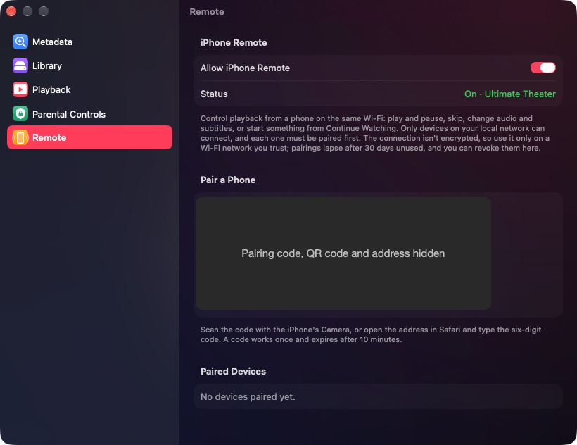

### Turning it on and pairing

1. In **Settings › Remote**, turn on **Allow iPhone Remote**. This needs the administrator profile, and the administrator PIN if one is set.
2. Under **Pair a Phone**, scan the QR code with the iPhone's Camera. Or open the address shown in Safari and type the six-digit **Code**.
3. A code works only once and expires after 10 minutes. It stays valid while the Remote pane is open. Click **New Code** to make a fresh one.

### What the remote does

- **Playback:** play and pause, back and forward 10 seconds, previous and next episode, **Skip Intro** and **Skip Credits**, the position bar, volume, and **Stop**.
- **Tracks:** change the **Audio** and **Subtitles**.
- **Finding something to watch:** start a title from **Continue Watching**, or **Search** your library.
- **On an Apple TV or another device:** the remote controls whatever is showing the picture.

### Revoking a phone

**Paired Devices** lists every phone with the date it was paired and when it was last used. Click **Revoke** to unpair one, or **Revoke All…** to unpair them all. A pairing also expires on its own after 30 days without use.

### Security notes

- The remote only accepts connections from your local network, and only from paired phones.
- The connection isn't encrypted, so only use the remote on a Wi-Fi network you trust.
- After too many wrong codes, pairing stops until you make a **New Code** on the Mac.

---

## 7. Watch Stats

**Watch Stats** (⌘8) shows what a profile has been watching.

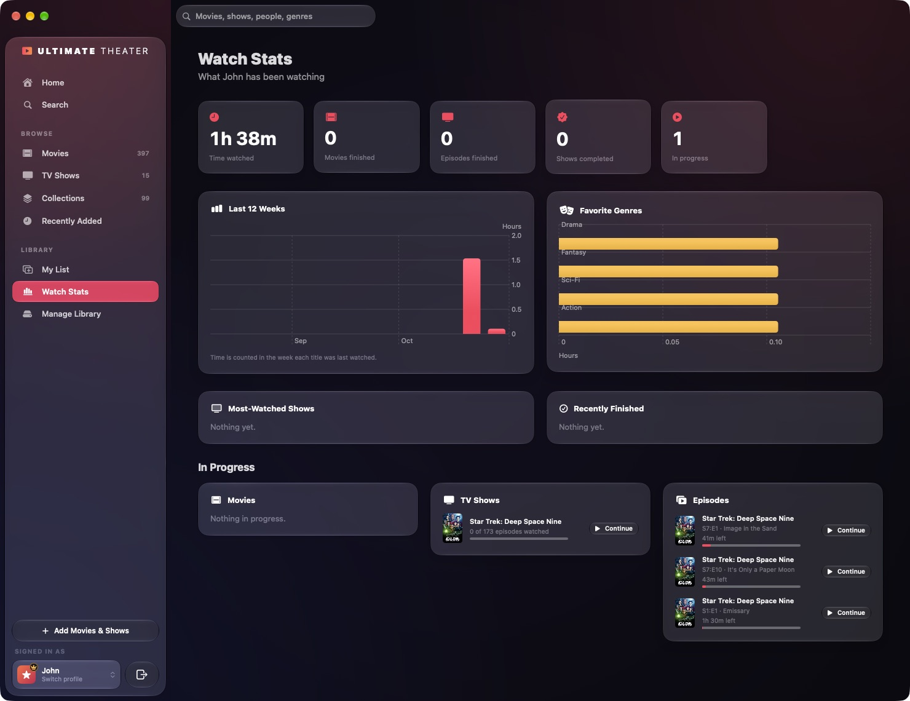

- **Totals.** **Time watched**, **Movies finished**, **Episodes finished**, **Shows completed** and **In progress**.
- **Last 12 Weeks.** Hours watched each week. Time is counted in the week each title was last watched.
- **Favorite Genres.** The genres you've spent the most hours on.
- **Most-Watched Shows** and **Recently Finished**.
- **In Progress.** Separate lists of movies, TV shows and episodes, each with a progress bar and a **Continue** button.

The administrator can choose any profile from the menu at the top right. **Continue** only appears for your own profile, so your viewing is never recorded on someone else's profile.

---

## 8. Settings reference

Open Settings with **Ultimate Theater › Settings…** (⌘,). Only the administrator can change these panes, except **Playback**, which every profile can change. Other profiles see **Administrator Only**, with a **Switch to Administrator…** button.

### Metadata

- **On/off switch for each source** (TMDB, OMDb, TVmaze and Wikipedia), with an API key field, a **Get a Free Key** link and **Test Connection**.
- **OpenSubtitles.** API key, plus an optional username and password, and **Check**.
- **Fetch info automatically when adding media.**
- The TMDB notice and the data licences.

### Library

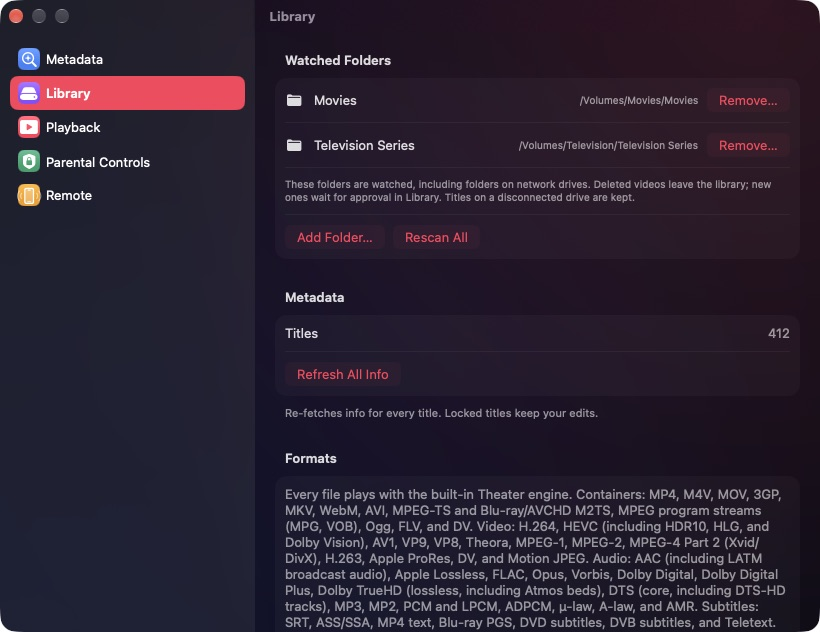

- **Watched Folders.** A list of folders with **Remove…**, plus **Add Folder…** and **Rescan All**.
- **Metadata.** The number of titles, and **Refresh All Info**. Locked titles keep your edits.
- **Formats.** Every format the Theater engine plays.
- **Databases.** The **Master library** (titles, episodes, watched folders) and **Users** (profiles, watch progress, My Lists, ratings) SQLite databases, with their sizes and **Show in Finder**.
- **Reset Ultimate Theater…** erases the library, every profile, the watch history, settings, saved API keys and caches, and returns the app to its first-launch state. Your movie files aren't touched.

### Playback

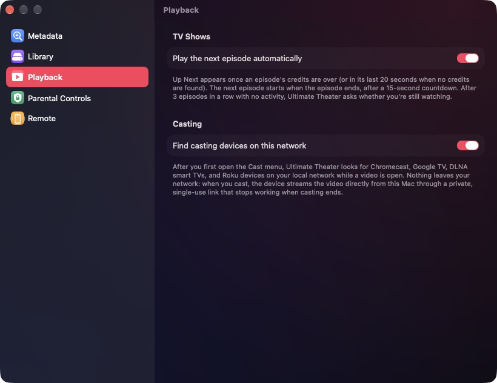

- **TV Shows › Play the next episode automatically.**
- **Casting › Find casting devices on this network.**

### Parental Controls

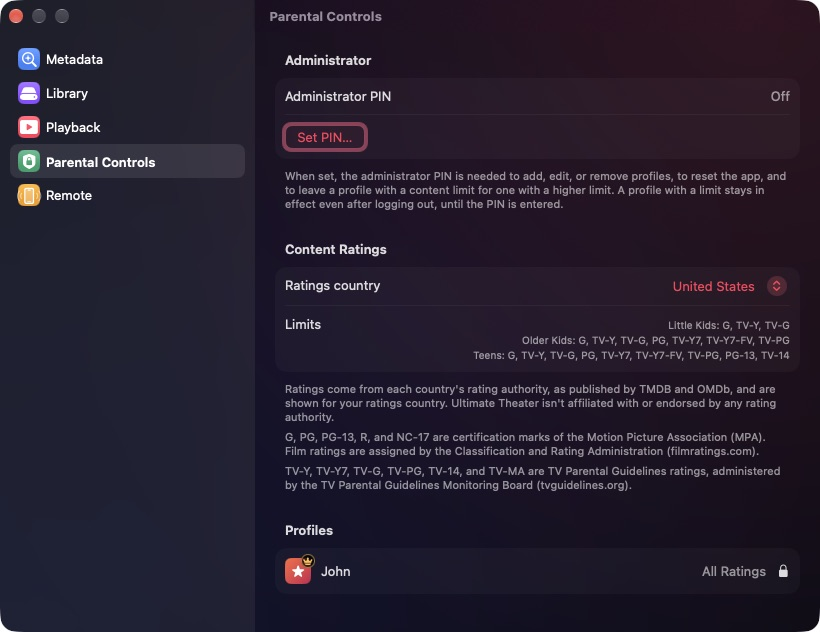

- **Administrator.** Shows whether the administrator PIN is on, with **Set PIN…**, **Change PIN…** and **Turn Off…**.
- **Content Ratings.** The **Ratings country**, and the ratings each limit allows.
- **Profiles.** Each profile's limit, and whether it has a PIN.

### Remote

- **Allow iPhone Remote**, and its status.
- **Pair a Phone.** The QR code, the six-digit code, the address and **New Code**.
- **Paired Devices**, with **Revoke** and **Revoke All…**.

---

## 9. Parental controls and ratings

### Rating limits

Every profile has one of four limits:

| Limit | What it allows | Examples (United States) |
| --- | --- | --- |
| **Little Kids** | Titles for all ages | G, TV-Y, TV-G |
| **Older Kids** | Adds parental-guidance titles | PG, TV-Y7, TV-Y7-FV, TV-PG |
| **Teens** | Adds titles for ages 13 and up | PG-13, TV-14 |
| **All Ratings** | No restrictions | R, NC-17, TV-MA |

A profile with a limit only sees titles at or below that level, everywhere in the app. **Show unrated titles** decides whether that profile also sees titles with no known rating, such as home videos.

### Ratings country

Choose the country whose rating system your household follows in the setup guide or in **Settings › Parental Controls**. There are 48 countries to choose from, including the United States, the United Kingdom, Ireland, Canada, Australia, New Zealand, Germany, France, Spain, Italy, the Netherlands, the Nordic countries, Japan, South Korea, India, Brazil and Mexico. Each country's ratings are sorted into the four limits, so the same profile works whichever country you choose.

**How a title's rating is chosen:**

1. The rating for your country, when one is known.
2. Otherwise, the strictest rating known from any other country (the safer choice).
3. Otherwise, the title's main rating.

Ratings come from TMDB and OMDb.

### Keeping limits in place

- **Set an administrator PIN.** Without one, anyone can switch from a limited profile to an unrestricted one.
- **Moving up needs the PIN.** With the PIN set, leaving a limited profile for a less restricted one needs it, and so does managing profiles.
- **Logging out doesn't remove the limit.** A limited profile stays in effect after logging out until the PIN is entered.
- **Lock profiles that need it.** You can also give any profile its own PIN.

---

## 10. Privacy

Ultimate Theater has no accounts, no advertising, no analytics and no tracking. Your profiles, watch history, My Lists, ratings and favourite scenes stay on your Mac, in the app's own databases.

**What is sent, and where:**

| Where | What is sent | When |
| --- | --- | --- |
| TMDB, OMDb, TVmaze, Wikipedia | Title names, years, season and episode numbers, and IDs, with your API key where one is needed. Posters and other artwork are downloaded from them. | When titles are added, refreshed or matched |
| OpenSubtitles.com | Your API key (and your login, if you added one), the title, year, episode, IDs, language and a fingerprint of the file | Only when you use **Find Subtitles…** |
| YouTube or Vimeo | A request for the trailer, through YouTube's privacy-enhanced (no-cookie) player | Only when you play a trailer |

Nothing about you or your household is sent: no names, no viewing history, no file paths.

**Your local network:**

- **The iPhone remote** is off unless the administrator turns it on. It only answers paired devices on your local network.
- **Casting** finds devices on your local network. While you cast, the Mac lets that one device stream that one file through a private link, which stops working when casting ends.
- macOS asks for **Local Network** permission the first time either is used.

**Your keys and PINs:**

- API keys and the administrator PIN are kept in your Mac's Keychain.
- Profile PINs are stored only as salted hashes, never as the PIN itself.

---

## 11. Troubleshooting and FAQ

**A title was matched to the wrong movie or show.**
Choose **Fix Match…**, search for the right one, and click **Use This Match**. Renaming the file as `Title (Year).ext` also helps.

**Titles show "Needs Match", or there's no artwork.**
Check that TMDB is turned on and has a working key (**Settings › Metadata › Test Connection**). Then use **Identify *n* Unmatched** in Manage Library.

**Collections is empty.**
Collections come from TMDB. Add a TMDB key, then choose **Refresh All Info**.

**A file shows "Can't Play".**
Its format isn't supported (for example WMV or VC-1), or the file is damaged. The title page explains which. Use **Check File for Damage…** to try a repair.

**"The file couldn't be found."**
The drive may be disconnected, or the file may have moved. Reconnect the drive and try again. If the file is gone, remove the title.

**New videos in my folders don't appear.**
New videos wait for approval under **Waiting for Approval** in Manage Library. Network drives are only checked every 5 minutes. Choose **Rescan Library Folders** (⇧⌘R) to check now.

**My subtitle file isn't listed.**
Give it the same name as the video (`Movie.srt` or `Movie.en.srt`), and keep it in the same folder as the video, inside a watched folder.

**Find Subtitles says a key is needed, or a download fails.**
Add an OpenSubtitles API key in **Settings › Metadata**. The free tier only allows a few downloads a day. Adding your OpenSubtitles login raises the limit.

**Skip Intro doesn't appear.**
Detection runs in the background after a show is added and when an episode starts. Give it a few minutes, especially for files on a network drive. Shows whose episodes don't share an opening theme can't be detected.

**No casting devices appear.**
Check that the Mac and the TV are on the same network, and that Local Network permission is on (**System Settings › Privacy & Security › Local Network**). Check that **Find casting devices on this network** is on in **Settings › Playback**. Then click **Refresh** in the Cast menu.

**AirPlay only sends sound.**
AirPlay video needs an MP4, M4V or MOV file with H.264 or HEVC video. Other files can only send their sound over AirPlay.

**The phone can't connect to the remote.**
Check that the phone is on the same Wi-Fi network as the Mac and that **Allow iPhone Remote** is on. If the code has expired, or pairing stopped after too many wrong codes, click **New Code**.

**I forgot the administrator PIN.**
On the PIN pad, click **Forgot PIN? Use Mac Password…**.

**The library couldn't be opened when the app started.**
Ultimate Theater offers **Move Damaged Library Aside and Start Fresh…**. The damaged database is kept, renamed, next to the new one, and your video files are never touched.

**Where is my data?**
Open **Settings › Library** and click **Show in Finder** under Databases.

**Can I start over?**
Use **Settings › Library › Reset Ultimate Theater…**. Your video files aren't touched.

---

## 12. Keyboard shortcuts

### App and browsing

| Shortcut | Action |
| --- | --- |
| ⌘1 | Home |
| ⌘2 | Movies |
| ⌘3 | TV Shows |
| ⌘4 | Collections |
| ⌘5 | Recently Added |
| ⌘6 | My List |
| ⌘7 | Manage Library (administrator) |
| ⌘8 | Watch Stats |
| ⌘F | Search |
| ⌘O | Add Movies & Shows… |
| ⇧⌘R | Rescan Library Folders |
| ⇧⌘P | Switch Profile… |
| ⌘0 | Show the main window (Window › Ultimate Theater) |
| ⌘, | Settings |
| Return | Play or Resume (title page and Home carousel) |
| ⌘L | Add to or remove from My List (title page) |
| ⇧⌘T | Watch the trailer (title page) |

### Profile screen

| Shortcut | Action |
| --- | --- |
| 1–9 | Choose a profile |
| ⌘E | Manage Profiles |
| ⇧⌘N | Add Profile |
| Escape | Done (while managing) / Cancel (in the editor) |
| 0–9, Delete | Type or erase PIN digits on the PIN pad |

### Player

| Shortcut | Action |
| --- | --- |
| Space | Play / Pause |
| ← / → | Back / Forward 10 seconds |
| ⇧← / ⇧→ | Previous / Next episode |
| ↑ / ↓ | Volume up / down |
| S | Skip Intro or Skip Credits |
| M | Mute / Unmute |
| F | Toggle full screen |
| B | Save Scene |
| N | Play Now (Up Next) |
| Escape | Close Episodes panel / leave full screen / picture-in-picture |
| ⌘↩ | Picture in Picture / Return to Player |
| ⌘. | Stop |

---

## 13. Data sources and trademarks

*This application uses TMDB and the TMDB APIs but is not endorsed, certified, or otherwise approved by TMDB.*

- **TMDB.** Movie and TV information and images from [TMDB](https://www.themoviedb.org).
- **TVmaze.** TV show and episode information from [TVmaze](https://www.tvmaze.com), licensed under [CC BY-SA 4.0](https://creativecommons.org/licenses/by-sa/4.0/).
- **Wikipedia.** Synopses and images from [Wikipedia](https://www.wikipedia.org), by Wikipedia contributors. The text is licensed under CC BY-SA 4.0; images carry their own licences.
- **OMDb.** Ratings from the [OMDb API](https://www.omdbapi.com). IMDb, Rotten Tomatoes and Metacritic are trademarks of their respective owners.
- **OpenSubtitles.** Downloaded subtitles come from [OpenSubtitles.com](https://www.opensubtitles.com), are contributed by its community, and are subject to the OpenSubtitles terms of service.
- **Trailers** are played from YouTube and Vimeo, and are subject to those services' terms.
- **Content ratings.** Ratings come from each country's rating authority, as published by TMDB and OMDb. Ultimate Theater isn't affiliated with or endorsed by any rating authority.
  - G, PG, PG-13, R and NC-17 are certification marks of the Motion Picture Association (MPA). Film ratings are assigned by the Classification and Rating Administration ([filmratings.com](https://www.filmratings.com)).
  - TV-Y, TV-Y7, TV-G, TV-PG, TV-14 and TV-MA are TV Parental Guidelines ratings, administered by the TV Parental Guidelines Monitoring Board ([tvguidelines.org](http://www.tvguidelines.org)).
  - Ratings from other countries belong to their respective authorities.

Apple, Mac, macOS, AirPlay, Apple TV, iPhone, Safari, Touch ID and Apple Watch are trademarks of Apple Inc. Google Cast, Chromecast and Google TV are trademarks of Google LLC. Roku is a trademark of Roku, Inc. Dolby, Dolby Vision, Dolby Atmos and Dolby TrueHD are trademarks of Dolby Laboratories. DTS is a trademark of DTS, Inc. DLNA is a trademark of the Digital Living Network Alliance. All other trademarks belong to their respective owners. Movie and TV artwork shown in screenshots belongs to its respective rights holders.

© 2026 John Aldrich. All rights reserved. See [LICENSE](../LICENSE) and [THIRD_PARTY_NOTICES.md](../THIRD_PARTY_NOTICES.md).
